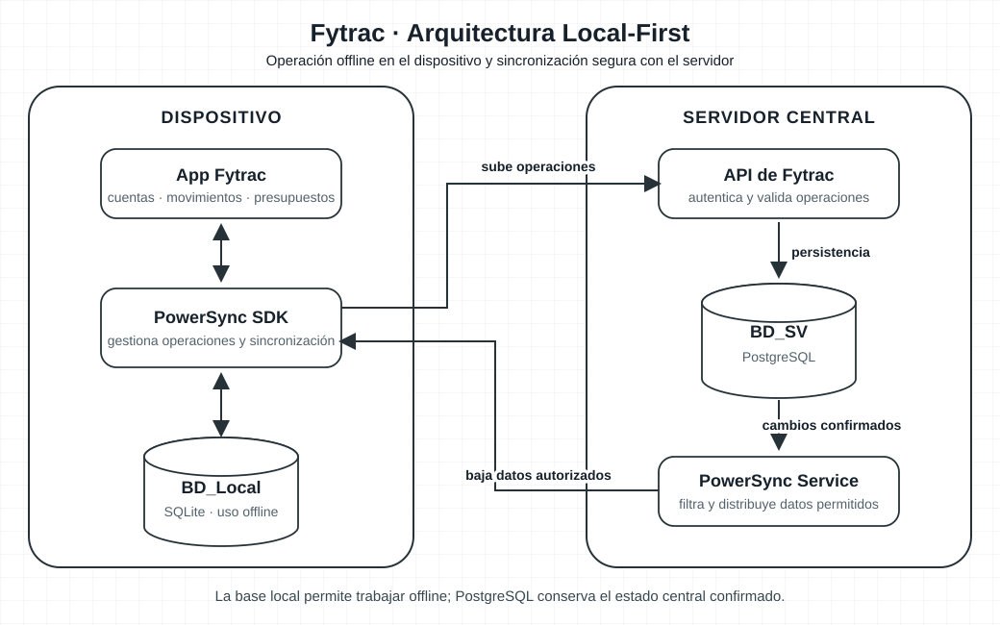

# Arquitectura Local-First y Sync

### Objetivo y justificación

Fytrac es una app financiera híbrida para registrar movimientos, administrar presupuestos y consultar proyecciones patrimoniales. El uso Local-First permite que estas funciones sigan disponibles cuando el teléfono pierde conexión.

- Las transacciones, cuentas y presupuestos se consultan desde la base local para que la interfaz responda sin esperar a la red.
- Las operaciones realizadas offline quedan pendientes en el dispositivo y se envían al recuperar conexión.
- PostgreSQL centraliza los datos confirmados y mantiene la integridad de la información compartida.
- Esta arquitectura responde especialmente a RNF-01 y RNF-07; el almacenamiento local y la sincronización también deben cumplir RNF-02.

La base local es la fuente inmediata para la interfaz del dispositivo. PostgreSQL es la fuente central para los datos confirmados y compartidos entre dispositivos. La sincronización es eventual: una operación pendiente no se considera confirmada por el servidor.

### Arquitectura propuesta

#### Componentes

- **App Fytrac:** presenta los datos y permite registrar movimientos sin conexión.
- **BD_Local:** una base SQLite en el dispositivo mantiene la réplica necesaria para operar offline. La selección final del motor local depende de la plataforma elegida.
- **PowerSync SDK:** se ejecuta en el cliente y participa en la persistencia local y la sincronización.
- **API de Fytrac:** autentica y valida las operaciones recibidas antes de escribirlas en el servidor.
- **PowerSync Service:** distribuye a cada cliente los cambios del servidor que correspondan a su ámbito autorizado.
- **BD_SV:** PostgreSQL conserva los datos centrales y aplica las restricciones e integridad transaccional del servidor.

El cliente no se conecta directamente a PostgreSQL. Las escrituras pasan por la API de Fytrac; la descarga de datos se limita a las filas autorizadas para la cuenta correspondiente.

### Flujo de sincronización

1. **Registro local:** el usuario crea o modifica una transacción, cuenta o presupuesto. La app guarda el cambio en BD_Local y lo muestra de inmediato como pendiente.
2. **Cola offline:** el SDK conserva la operación mientras el dispositivo no tiene conexión. Cada operación debe tener un identificador estable para poder reconocer reintentos.
3. **Envío al servidor:** cuando vuelve la conexión, el cliente envía las operaciones pendientes a la API mediante HTTPS.
4. **Validación:** la API comprueba la sesión, la pertenencia de los datos, los permisos, el formato y las reglas de negocio.
5. **Persistencia central:** las operaciones aceptadas se guardan en PostgreSQL dentro de transacciones del servidor.
6. **Distribución:** PowerSync Service entrega los cambios confirmados a los clientes autorizados; el SDK actualiza BD_Local y la interfaz refleja el nuevo estado.
7. **Rechazo o conflicto:** si el servidor no acepta una operación, el cliente la marca como requiere atención y comunica al usuario qué puede corregir.

La API debe ser idempotente: si se reintenta una operación porque se perdió la respuesta de red, el servidor no debe duplicar la transacción ni sus efectos.

### Consistencia y manejo de conflictos

La arquitectura usa consistencia eventual entre dispositivos. Los cambios locales se muestran rápido en el dispositivo de origen, pero el resto de los dispositivos los recibe después de la validación del servidor.

Para proteger la integridad financiera:

- Los reintentos se identifican con un ID de operación y no generan movimientos duplicados.
- Los registros editables pueden usar una versión para detectar si otro dispositivo cambió el mismo dato.
- No se aplicará automáticamente la regla “gana la última escritura” a saldos, transacciones o presupuestos.
- Una transacción ya confirmada debe corregirse de forma auditable, por ejemplo mediante una reversa o ajuste, en vez de desaparecer sin rastro.
- Las reglas exactas de resolución se definirán por entidad cuando se complete el modelo de datos.

| Caso | Tratamiento inicial |
| --- | --- |
| Alta de una transacción offline | Crear un identificador único en el cliente y validarlo en el servidor al sincronizar. |
| Reintento por pérdida de conexión | Reconocer el mismo ID de operación y evitar guardar dos veces. |
| Edición concurrente de un presupuesto | Detectar versión desactualizada y solicitar resolución según la regla de negocio. |
| Cambio no permitido | Rechazarlo en el servidor y dejar un estado visible para que el usuario pueda actuar. |
| Eliminación offline | Propagar una marca de eliminación hasta los dispositivos que estuvieron desconectados; definir luego la retención. |

### Selección de la tecnología

**PowerSync** es el candidato inicial porque su enfoque se alinea con la sincronización entre una base local SQLite y PostgreSQL, que son las bases planteadas para Fytrac. Permite separar el trabajo local del cliente y la validación de las escrituras en el backend.

La selección todavía es **provisional**. Antes de cerrarla se debe comprobar:

- Que el SDK esté disponible y sea adecuado para la plataforma móvil/web seleccionada.
- Que el flujo de escritura offline pueda integrarse con la API y las reglas financieras de Fytrac.
- Que las reglas de sincronización permitan aislar cuentas y datos correctamente.
- Que las migraciones de BD_Local funcionen con clientes que estuvieron offline.
- La modalidad de despliegue, operación, límites y costos para el volumen esperado.

La documentación oficial de referencia está en [docs.powersync.com](https://docs.powersync.com/). Si el SDK o el despliegue no se ajustan a las necesidades del proyecto, se comparará con una alternativa antes de implementar la sincronización completa.

### Seguridad, privacidad y RNF-02

La app manejará información financiera localmente, por lo que el acceso offline debe quedar incluido en la política de seguridad:

- Usar TLS para la comunicación entre el dispositivo, la API y los servicios de sincronización.
- Definir el cifrado de BD_Local y la protección de claves disponible en cada sistema operativo.
- Sincronizar solo los datos que se necesiten para las tareas offline.
- Al cerrar sesión, cambiar de cuenta o revocar el acceso, proteger o eliminar los datos locales según la política acordada.
- Verificar los permisos tanto al enviar una escritura como al descargar datos.
- Definir retención, respaldos, registros de auditoría y cumplimiento normativo dentro de RNF-02.
- Mantener aislado el módulo de captura de datos de billeteras, en línea con RNF-06; no debe recibir tokens criptográficos ni credenciales bancarias.

El acceso offline puede dejar información sensible en el dispositivo. El nivel de cifrado, el período de retención y el comportamiento ante pérdida del teléfono deben acordarse antes de producción.

### Decisiones pendientes

- Plataforma y framework de la app.
- Motor local definitivo y mecanismo de cifrado en cada plataforma.
- Datos y períodos que deben estar disponibles sin conexión.
- Modelo de cuentas, perfiles y permisos para filtrar la sincronización.
- Política de conflicto para transacciones, presupuestos, categorías y cuentas.
- Modalidad de despliegue de PowerSync y objetivos de operación.
- Requisitos normativos, retención y auditoría de RNF-02.

### Validación en Sprint 0

Implementar una prueba vertical pequeña que permita:

1. Registrar una transacción en modo avión y verla inmediatamente en la app.
2. Reiniciar el teléfono y comprobar que el dato pendiente sigue localmente disponible.
3. Recuperar conexión y verificar que PostgreSQL recibe una sola operación.
4. Sincronizar el movimiento con otro cliente autorizado.
5. Confirmar que una cuenta no puede leer movimientos de otra.
6. Probar un conflicto por edición simultánea y mostrar una resolución comprensible.
7. Migrar una base local antigua que todavía tenga operaciones pendientes.

Al concluir esta validación, Fytrac podrá cerrar la tecnología de sincronización y continuar con el diseño detallado del esquema PostgreSQL y RNF-02.
